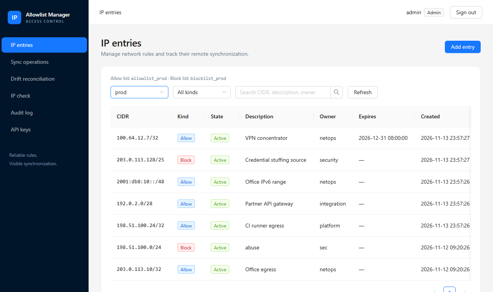
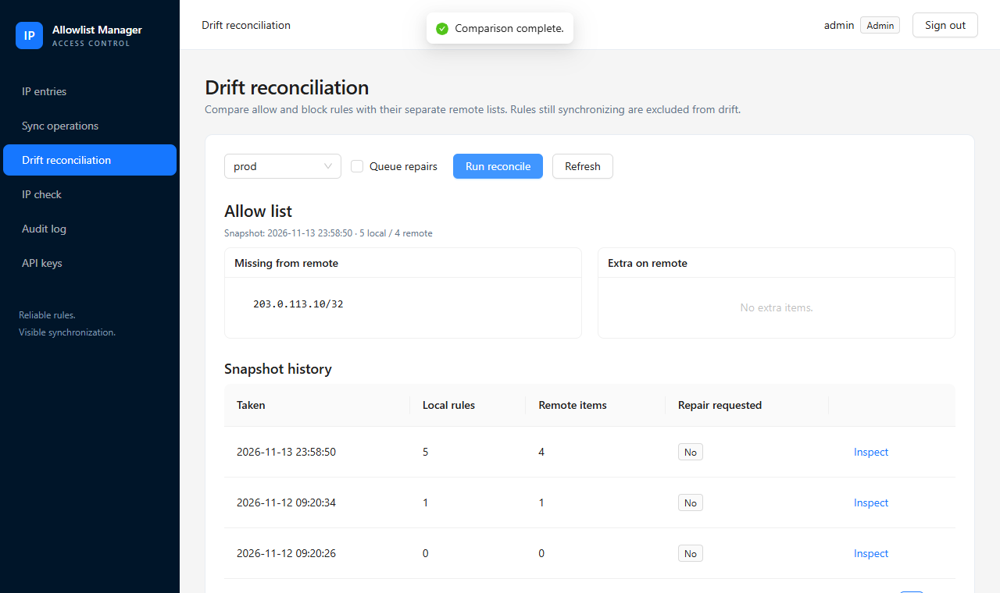
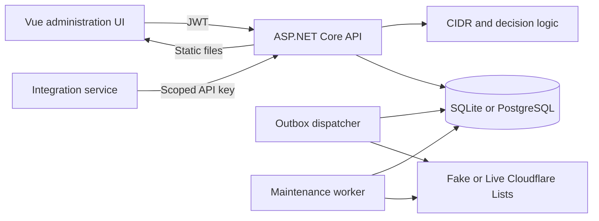

English | [繁體中文](README.zh-TW.md)

# IP Allowlist Manager

[](https://github.com/Marc-YULIN/ip-allowlist-manager/actions/workflows/ci.yml)  

Manage environment-specific IP allow/block rules, synchronize them with Cloudflare Lists through a durable outbox, and expose a scoped IP-decision API.

## Background

Distilled from patterns I built and operated in production payment / membership platforms. This repository is a clean-room implementation with synthetic data.

## Features

- IPv4/IPv6 normalization, overlap detection, expiry, and Block-first decisions across dev, staging, and prod.
- Separate Cloudflare Lists for Allow and Block in every environment; WAF rules reference the allow list for skip/allow and the block list for block actions.
- Durable synchronization with atomic claims, renewable leases, dispatch evidence, bounded retries, and recovery of uncertain results.
- Per-list drift snapshots and explicitly requested repairs; synchronizing rules are excluded from missing/extra results, and unknown remote items remain untouched by default.
- Eight-hour JWT sessions for administrators and viewers; separate scoped, revocable integration keys.
- A Vue administration interface, development-only browser CORS, structured logs, and traceable audit records.
- Fake remote mode by default; a Live Cloudflare client and SQLite/PostgreSQL providers are included.

Administration screen guide:

| Screen | What to inspect |
| --- | --- |
| Entries | Environment, allow/block list names, kind, search, lifecycle tags, owner, expiry; administrators can create and remove rules. |
| Operations | Outbox state, retries, and expandable evidence around each dispatch. |
| Drift | Separate Allow list and Block list sections with missing/extra items and snapshot histories; administrators can reconcile and request repairs. |
| Audit log | Administrator-only filters and before/after JSON. |
| API keys | Administrator-only creation, one-time secret display, scopes, and revocation. |
| IP check | Decision and matched rule for the selected environment. |

## Screenshots



*IP entries with allow / block lists per environment*



*Drift reconciliation detecting an entry missing from the remote list*

## Architecture



See [架構說明 (architecture.md)](docs/architecture.md) for sequence, state, and data diagrams.

## Tech Stack

| Layer | Technology |
| --- | --- |
| API | .NET 10, ASP.NET Core Minimal APIs, JWT Bearer, Scalar/OpenAPI |
| Storage | EF Core 10, SQLite by default, PostgreSQL optionally |
| Interface | Vue 3, TypeScript 6, Ant Design Vue 4, Pinia, Vue Router, Vite 8 |
| Tests | xUnit, NSubstitute, ASP.NET Core integration host, Vitest |
| Delivery | Node.js 20, three-stage container build, Docker Compose, GitHub Actions |

## Getting Started

### Local development

Prerequisites: the .NET SDK selected by SDK 版本設定 (global.json), Node.js 20.19 or later within the 20.x line, and installed/restored dependencies. The commands below use the existing NuGet restore; restore dependencies separately when preparing a fresh checkout.

```sh
cd frontend
npm ci
npm run build
cd ..
dotnet run --project src/Allowlist.Api --no-restore
```

Open <http://localhost:5106>. Development seeds `admin` and `viewer` with password `ChangeMe!2026` on a new database. The administrator can write; the viewer can browse entries, operations, snapshots, and IP decisions. Seeds do not reset existing users or passwords.

For hot reload, run `npm run dev` in `frontend` in a second terminal and open <http://localhost:5173>; API calls are proxied to port 5106. The API serves the built frontend after the frontend build. Scalar is at `/scalar`, the OpenAPI document is at `/openapi/v1.json`, and `/health` is an application liveness check, without database/remote dependency probes.

### Docker Compose

Copy `.env.example` to `.env` (git-ignored) at the repository root and set your own values:

```dotenv
POSTGRES_PASSWORD=replace-with-a-random-database-password
JWT_SIGNING_KEY=replace-with-a-random-signing-key-at-least-32-bytes
ADMIN_PASSWORD=replace-with-a-strong-admin-password
VIEWER_PASSWORD=replace-with-a-separate-viewer-password
```

```sh
docker compose up --build
```

Open <http://localhost:5106> and sign in as `admin` with your configured password. Compose uses PostgreSQL 17, Production settings, and Fake remote mode. The viewer is optional: omit its password to skip creation. PostgreSQL data and application key files use named volumes. `docker compose down` preserves those volumes. Container builds require package registries and base images to be accessible.

## Configuration

Use `__` instead of `:` in environment variables, for example `Database__Provider=Postgres`. Never use the development signing key or demo passwords for deployment. Terminate HTTPS at your deployment ingress before exposing credentials outside local development.

| Key | Default | Description |
| --- | --- | --- |
| `ASPNETCORE_ENVIRONMENT` | Host-dependent; local launch profile: `Development` | Compose explicitly selects `Production`. |
| `ASPNETCORE_URLS` | Local profile: `http://localhost:5106` | Container: `http://+:5106`. |
| `Database:Provider` | `Sqlite` | `Sqlite` or `Postgres`. |
| `ConnectionStrings:Sqlite` | `Data Source=appdata/allowlist.db` | Relative to the API content root. |
| `ConnectionStrings:Postgres` | Unset | Required for PostgreSQL. Compose supplies an internal connection string. |
| `Jwt:SigningKey` | Development-only demo key | Required otherwise; at least 32 UTF-8 bytes. |
| `Jwt:Issuer` / `Jwt:Audience` | `allowlist-manager` | Token issuer and audience. |
| `Seed:AdminUsername` | `admin` | Initial administrator name. |
| `Seed:AdminPassword` | `ChangeMe!2026` in Development | Otherwise unset; missing password skips administrator seeding. |
| `Seed:ViewerPassword` | `ChangeMe!2026` in Development | Otherwise unset; optional viewer is created with the initial administrator. |
| 開發允許清單識別碼 (Seed:DevAllowListId) | `demo-dev-allow` | Allow list for dev. |
| 開發封鎖清單識別碼 (Seed:DevBlockListId) | `demo-dev-block` | Block list for dev. |
| 預備允許清單識別碼 (Seed:StagingAllowListId) | `demo-staging-allow` | Allow list for staging. |
| 預備封鎖清單識別碼 (Seed:StagingBlockListId) | `demo-staging-block` | Block list for staging. |
| 正式允許清單識別碼 (Seed:ProdAllowListId) | `demo-prod-allow` | Allow list for prod. |
| 正式封鎖清單識別碼 (Seed:ProdBlockListId) | `demo-prod-block` | Block list for prod. |
| `Cloudflare:Mode` | `Fake` | `Fake` or `Live`. |
| `Cloudflare:ApiBase` | `https://api.cloudflare.com/client/v4` | Live API base URL. |
| `Cloudflare:AccountId` / `Cloudflare:ApiToken` | Empty | Required in Live mode; provision lists and a token with list permissions. |
| `Cloudflare:AllowRemoveUnknown` | `false` | Allows queued deletion of unknown remote items only during explicitly requested auto-fix. |
| `Cloudflare:MaxAttempts` | `6` | Bounded retry budget; valid range 1–20. |
| `Cloudflare:Fake:FailureRate` | `0` | Probability 0–1 of explicit rejection. |
| `Cloudflare:Fake:TimeoutRate` | `0` | Probability 0–1 of a timeout after applying a mutation. |

Remote list IDs are seeded only for new environments. Changing seed configuration does not update existing environment rows. In Live mode provision six distinct lists and set all six IDs before creating the initial database. Configure WAF rules separately: reference each allow list with a skip/allow action and each block list with a block action. Set rule order and skip scope to preserve Block precedence; this application does not provision WAF rules. Fake mode keeps each list independently in memory.

This schema replaces the former single-list mapping; `EnsureCreated` does not upgrade an existing database. Use a fresh demo database or arrange a data migration before upgrading a deployment.

## API Walkthrough

The Bash example uses `curl` and `jq`, runs against Fake mode, and uses reserved documentation IP ranges. For Compose, replace the password with the configured one. Use a fresh database or remove previous demo entries before rerunning.

```bash
set -e
BASE=http://localhost:5106
TOKEN=$(curl -fsS "$BASE/api/auth/login" \
  -H 'Content-Type: application/json' \
  -d '{"username":"admin","password":"ChangeMe!2026"}' | jq -er .token)

ALLOW=$(curl -fsS "$BASE/api/environments/dev/entries" \
  -H "Authorization: Bearer $TOKEN" -H 'Content-Type: application/json' \
  -d '{"cidr":"192.0.2.0/24","kind":"Allow","description":"Demo office","owner":"Demo operator"}')
ALLOW_ID=$(echo "$ALLOW" | jq -er .entry.id)
BLOCK=$(curl -fsS "$BASE/api/environments/dev/entries" \
  -H "Authorization: Bearer $TOKEN" -H 'Content-Type: application/json' \
  -d '{"cidr":"192.0.2.7","kind":"Block","description":"Demo exclusion","owner":"Demo operator"}')
BLOCK_ID=$(echo "$BLOCK" | jq -er .entry.id)

# HTTP 201 confirms local persistence, not remote completion.
READY=false
for attempt in $(seq 1 30); do
  ENTRIES=$(curl -fsS "$BASE/api/environments/dev/entries" -H "Authorization: Bearer $TOKEN")
  if echo "$ENTRIES" | jq -e --arg a "$ALLOW_ID" --arg b "$BLOCK_ID" \
    '[.items[] | select(.id == $a or .id == $b) | .state] | length == 2 and all(. == "Active")' >/dev/null; then
    READY=true
    break
  fi
  sleep 2
done
test "$READY" = true
curl -fsS "$BASE/api/operations" -H "Authorization: Bearer $TOKEN" | jq .

# Expect allowed=true for .8, and blocked=true for .7.
curl -fsS "$BASE/api/check?ip=192.0.2.8&env=dev" -H "Authorization: Bearer $TOKEN" | jq .
curl -fsS "$BASE/api/check?ip=192.0.2.7&env=dev" -H "Authorization: Bearer $TOKEN" | jq .

CLIENT=$(curl -fsS "$BASE/api/integration-clients" \
  -H "Authorization: Bearer $TOKEN" -H 'Content-Type: application/json' \
  -d '{"name":"Demo service","scopes":["ip:check","allowlist:read"]}')
API_KEY=$(echo "$CLIENT" | jq -er .key)
CLIENT_ID=$(echo "$CLIENT" | jq -er .id)
curl -fsS "$BASE/api/check?ip=192.0.2.8&env=dev" -H "X-Api-Key: $API_KEY" | jq .
curl -fsS "$BASE/api/integration/dev/entries" -H "X-Api-Key: $API_KEY" | jq .

# Returns two snapshots, distinguished by listKind: Allow and Block.
curl -fsS -X POST "$BASE/api/environments/dev/reconcile?autoFix=false" \
  -H "Authorization: Bearer $TOKEN" | jq .
curl -fsS -X POST "$BASE/api/integration-clients/$CLIENT_ID/revoke" -H "Authorization: Bearer $TOKEN"
curl -fsS -X DELETE "$BASE/api/environments/dev/entries/$BLOCK_ID" -H "Authorization: Bearer $TOKEN"
curl -fsS -X DELETE "$BASE/api/environments/dev/entries/$ALLOW_ID" -H "Authorization: Bearer $TOKEN"
```

The integration secret is returned only at creation. After revocation it returns HTTP 401. Integration writes require `allowlist:write` on `/api/integration/{env}/entries`; the example key intentionally grants only read/check access. Inspect operations until removal completes. Failures use `ProblemDetails` with a machine-readable error code and trace ID. Search/list endpoints return 20-item pages; snapshots return the latest 100.

## Design Decisions

1. **Transactional outbox and leased claims.** IP 規則 (IpEntry), 遠端操作 (RemoteOperation), and 稽核紀錄 (AuditLog) are saved together. Conditional EF updates claim at most 20 operations with a worker ID and renewable 60-second lease, keeping external calls outside the transaction. The dispatcher checks every two seconds; multiple workers cannot claim the same valid lease.
2. **Persist before dispatch.** 派發證據 (RemoteDispatchLog) records `Dispatching` before a remote mutation. Recovery sees that evidence and observes the remote state before deciding whether another dispatch is necessary. This provides recoverable intent, rather than an exactly-once guarantee across an external API boundary.
3. **Uncertain results require observation.** Timeouts become `Uncertain`, not immediate Add retries. 漂移比對服務 (DriftReconciler) checks known bulk-operation progress and current list contents. Desired state completes the operation; confirmed absence of the desired state consumes the retry budget. Explicit failures back off by `min(600, 5 × 2^attempts)` seconds and eventually reach `DeadLetter`.
4. **Unknown remote items are protected.** Scheduled comparison runs every ten minutes without repairs. An administrator can request repairs, but deletion of extra remote items also requires `Cloudflare:AllowRemoveUnknown=true`. Snapshot auto-fix status records the request; repairs are asynchronous and need their own completion check. Expiry and uncertain-result recovery run every minute. Per-list comparison excludes normalized CIDRs of PendingAdd/PendingRemove rules and rules with Pending/InFlight/Uncertain operations from both missing and extra results. Unknown items already queued for removal are also excluded while that operation is open.
5. **Keys have a lookup prefix and a one-time secret.** Only the SHA-256 hash is stored, looked up by an eight-character prefix and verified with `FixedTimeEquals`. Prefixes stay unique even after revocation; creation retries a collision at most five times. A high-entropy key does not need password-style stretching. Passwords separately use salted PBKDF2-SHA256 with 100,000 iterations.
6. **Human and service permissions are distinct.** JWT roles guard administration routes, while integration routes check `allowlist:read`, `allowlist:write`, or `ip:check`. A viewer cannot write; an API key cannot administer users or keys. Failed logins are limited per application instance and source IP: the tenth failure within five minutes returns HTTP 429.
7. **CIDR rules favor explicit intent.** Bare IPs become `/32` or `/128`; mapped addresses normalize to IPv4; host-bit mistakes report a suggested network. `0.0.0.0/0` and `::/0` are rejected. Block overrides Allow and only unexpired Active rules affect local decisions.
8. **Two relational providers, one model.** SQLite is convenient locally; Compose exercises PostgreSQL. UTC timestamps are stored as integer ticks for consistent comparison. A nullable unique live-rule key preserves uniqueness until a rule is removed. Startup uses `EnsureCreated`, so schema upgrades require a deliberate migration strategy. There are no monetary fields requiring fixed-point conversion.
9. **Allow and Block have separate remote targets.** Each environment owns an allow list and a block list. WAF rules must reference them separately: skip/allow for the allow list and block for the block list, with rule ordering and skip scope preserving Block precedence. Synchronization does not configure WAF policies. Rules sharing a CIDR across kinds remain independent; removing one kind never removes the other list's item. 遠端操作 (RemoteOperation) persists its target 清單識別碼 (ListId) when queued, so dispatch, uncertain-result observation, and remote item lookup keep the same target even if environment mappings change. Each reconciliation returns two 漂移快照 (DriftSnapshot), distinguished by 清單種類 (ListKind). Fake state is process-local and resets on restart; local rows persist and manual auto-fix can restore missing remote contents. Use one API instance in Fake mode.

## Testing

With dependencies already restored/installed:

```sh
dotnet build Allowlist.slnx --no-restore
dotnet test Allowlist.slnx --no-restore
cd frontend
npm run test
npm run build
```

Backend tests use isolated SQLite databases and stubbed remote clients/HTTP handlers. Frontend tests cover CIDR validation. No test needs a live Cloudflare account. Continuous integration restores first, builds/tests .NET in Release, and runs frontend tests/build under Node.js 20 in a separate job. Container startup, PostgreSQL behavior, and browser interaction still deserve deployment smoke checks.

## Project Structure

```text
src/Allowlist.Core/            Domain entities, CIDR logic, remote contract
src/Allowlist.Infrastructure/  EF storage, remote clients, outbox, maintenance
src/Allowlist.Api/             Authentication, endpoints, configuration, static UI
tests/Allowlist.Tests/         Domain, dispatcher, remote-client and API tests
frontend/                     Vue administration interface and Vitest tests
docs/architecture.md          Component, sequence, state, and data diagrams
```

## Roadmap

- Versioned database migrations and provider-specific CI verification.
- Durable shared remote simulation for multi-instance demonstrations.
- Metrics, alerting, and a shared login-throttling store for scaled deployments.
- Browser smoke tests and deployment-specific Cloudflare firewall-policy wiring.

## License

MIT. See [授權條款 (LICENSE)](LICENSE).
