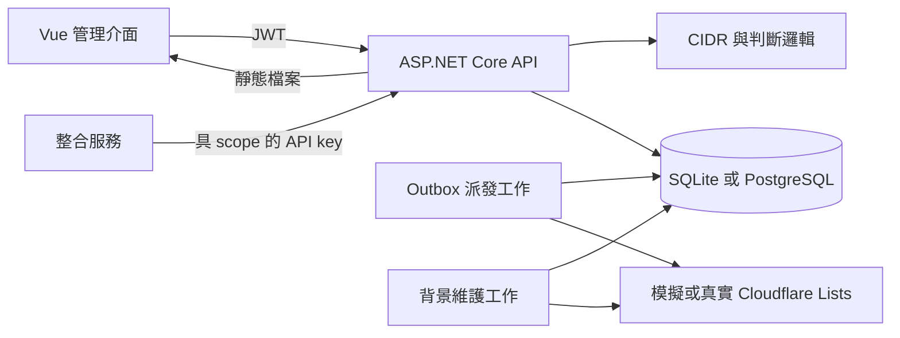

[English](README.md) | 繁體中文

# IP 白名單管理系統

[](https://github.com/Marc-YULIN/ip-allowlist-manager/actions/workflows/ci.yml)  

集中管理各環境的 IP 允許／封鎖規則，以持久化 outbox 同步到 Cloudflare Lists，並提供具權限範圍的 IP 判斷 API。

## 背景

從我在正式金流／會員平台建置與維運的實務模式中提煉而成。本儲存庫採獨立重新實作，使用的都是合成資料。

## 功能

- 支援 IPv4／IPv6 正規化、網段重疊檢查、到期移除，以及 dev、staging、prod 環境的封鎖優先判斷。
- 每個環境的 Allow 與 Block 各用一張 Cloudflare List；WAF 規則分別引用允許清單執行 skip／allow、封鎖清單執行 block。
- 同步工作具備原子領取、可續期租約、派發證據、有限重試與不確定結果恢復。
- 依清單保存漂移快照，可明確要求修復；同步中規則不列入缺少／多出項目，預設保留遠端未知項目。
- 管理員與唯讀使用者使用八小時 JWT；系統整合另用可撤銷且具 scope 的金鑰。
- 提供 Vue 管理介面、僅開發環境啟用的瀏覽器跨來源存取、結構化日誌與可追查稽核紀錄。
- 預設使用模擬遠端模式，另提供真實 Cloudflare client，以及 SQLite／PostgreSQL。

後台畫面說明：

| 畫面 | 檢視重點 |
| --- | --- |
| IP 清單（Entries） | 環境、允許／封鎖清單名稱、種類、搜尋、狀態標籤、負責人與到期時間；管理員可新增及移除。 |
| 同步操作（Operations） | outbox 狀態、重試，以及可展開的派發證據。 |
| 漂移比對（Drift） | 允許與封鎖兩區各自顯示遠端缺少／多出項目及歷史快照；管理員可執行比對及要求修復。 |
| 稽核紀錄（Audit log） | 管理員專用篩選，以及異動前後的 JSON。 |
| 整合金鑰（API keys） | 管理員建立金鑰、查看一次性密鑰、設定 scope 及撤銷。 |
| IP 查詢（IP check） | 指定環境的判斷結果與命中規則。 |

## 架構



元件、時序、狀態與資料模型請見[架構說明 (architecture.md)](docs/architecture.md)。

## 技術組成

| 層級 | 技術 |
| --- | --- |
| API | .NET 10、ASP.NET Core Minimal APIs、JWT Bearer、Scalar／OpenAPI |
| 儲存 | EF Core 10，預設 SQLite，可選 PostgreSQL |
| 介面 | Vue 3、TypeScript 6、Ant Design Vue 4、Pinia、Vue Router、Vite 8 |
| 測試 | xUnit、NSubstitute、ASP.NET Core 整合測試主機、Vitest |
| 交付 | Node.js 20、三階段容器建置、Docker Compose、GitHub Actions |

## 快速開始

### 本機開發

先備妥 SDK 版本設定 (global.json) 指定的 .NET SDK、20.x 系列且至少 20.19 的 Node.js，以及已安裝／還原的相依套件。以下指令沿用既有 NuGet 還原結果；第一次取得儲存庫時，請先完成相依套件還原。

```sh
cd frontend
npm ci
npm run build
cd ..
dotnet run --project src/Allowlist.Api --no-restore
```

開啟 <http://localhost:5106>。Development 模式會在新資料庫建立 `admin` 與 `viewer`，兩者密碼都是 `ChangeMe!2026`。管理員可以寫入，唯讀使用者可以檢視規則、同步操作、快照與 IP 判斷。初始化不會重設既有帳號或密碼。

需要即時更新時，在另一個終端的 `frontend` 目錄執行 `npm run dev`，開啟 <http://localhost:5173>；API 請求會代理到 5106。前端建置後也能由 API 提供靜態頁面。Scalar 位於 `/scalar`、OpenAPI 文件位於 `/openapi/v1.json`；`/health` 只檢查應用程式存活，不探測資料庫或遠端服務。

### Docker Compose

把根目錄的 `.env.example` 複製成 `.env`（不進版控），填入自己的值：

```dotenv
POSTGRES_PASSWORD=replace-with-a-random-database-password
JWT_SIGNING_KEY=replace-with-a-random-signing-key-at-least-32-bytes
ADMIN_PASSWORD=replace-with-a-strong-admin-password
VIEWER_PASSWORD=replace-with-a-separate-viewer-password
```

```sh
docker compose up --build
```

開啟 <http://localhost:5106>，使用 `admin` 與設定的密碼登入。Compose 使用 PostgreSQL 17、Production 設定與模擬遠端模式。唯讀帳號為選用，省略其密碼即可略過建立。PostgreSQL 資料與應用程式金鑰檔分別保存在具名 volume；`docker compose down` 會保留資料。建置容器時須能存取套件來源及基礎映像。

## 設定

環境變數以 `__` 取代 `:`，例如 `Database__Provider=Postgres`。部署時請替換開發簽章金鑰與示範密碼；在本機以外傳送帳密前，請由部署入口提供 HTTPS。

| 設定鍵 | 預設值 | 說明 |
| --- | --- | --- |
| `ASPNETCORE_ENVIRONMENT` | 依主機而定；本機啟動設定為 `Development` | Compose 明確設為 `Production`。 |
| `ASPNETCORE_URLS` | 本機啟動設定為 `http://localhost:5106` | 容器設為 `http://+:5106`。 |
| `Database:Provider` | `Sqlite` | 可選 `Sqlite` 或 `Postgres`。 |
| `ConnectionStrings:Sqlite` | `Data Source=appdata/allowlist.db` | 相對於 API 內容根目錄。 |
| `ConnectionStrings:Postgres` | 未設定 | PostgreSQL 必填；Compose 提供內部連線字串。 |
| `Jwt:SigningKey` | 僅 Development 有示範金鑰 | 其他環境必填，至少 32 個 UTF-8 bytes。 |
| `Jwt:Issuer` / `Jwt:Audience` | `allowlist-manager` | Token 簽發者與受眾。 |
| `Seed:AdminUsername` | `admin` | 初始管理員名稱。 |
| `Seed:AdminPassword` | Development 為 `ChangeMe!2026` | 其他環境未設定；缺少密碼時略過管理員初始化。 |
| `Seed:ViewerPassword` | Development 為 `ChangeMe!2026` | 其他環境未設定；選用的唯讀帳號會隨初始管理員建立。 |
| 開發允許清單識別碼 (Seed:DevAllowListId) | `demo-dev-allow` | dev 的允許清單。 |
| 開發封鎖清單識別碼 (Seed:DevBlockListId) | `demo-dev-block` | dev 的封鎖清單。 |
| 預備允許清單識別碼 (Seed:StagingAllowListId) | `demo-staging-allow` | staging 的允許清單。 |
| 預備封鎖清單識別碼 (Seed:StagingBlockListId) | `demo-staging-block` | staging 的封鎖清單。 |
| 正式允許清單識別碼 (Seed:ProdAllowListId) | `demo-prod-allow` | prod 的允許清單。 |
| 正式封鎖清單識別碼 (Seed:ProdBlockListId) | `demo-prod-block` | prod 的封鎖清單。 |
| `Cloudflare:Mode` | `Fake` | 可選 `Fake` 或 `Live`。 |
| `Cloudflare:ApiBase` | `https://api.cloudflare.com/client/v4` | 真實模式的 API 基底網址。 |
| `Cloudflare:AccountId` / `Cloudflare:ApiToken` | 空白 | 真實模式必填，請先建立清單與具清單權限的 token。 |
| `Cloudflare:AllowRemoveUnknown` | `false` | 只有明確要求自動修復時，才允許排程刪除遠端未知項目。 |
| `Cloudflare:MaxAttempts` | `6` | 重試次數上限，接受 1–20。 |
| `Cloudflare:Fake:FailureRate` | `0` | 明確拒絕的機率，接受 0–1。 |
| `Cloudflare:Fake:TimeoutRate` | `0` | 已套用異動後模擬逾時的機率，接受 0–1。 |

遠端清單識別碼只在新增環境時初始化。修改初始化設定不會更新既有環境資料；真實模式應先建立六張不同的清單，並在首次建立資料庫前設定六個識別碼。WAF 規則需分別引用允許清單執行 skip／allow、封鎖清單執行 block，並設定規則順序及跳過範圍以維持封鎖優先；本系統不會建立 WAF 規則。模擬模式會在記憶體中分別維護各清單。

本次資料結構取代舊版單一清單對應；`EnsureCreated` 不會升級既有資料庫。請使用新的示範資料庫，或於部署升級前安排資料遷移。

## API 操作範例

以下 Bash 範例使用 `curl`、`jq`、模擬遠端模式與文件保留 IP 網段。使用 Compose 時，請替換成設定的密碼。重新執行前，請使用新資料庫或先移除上次的示範規則。

```bash
set -e
BASE=http://localhost:5106
TOKEN=$(curl -fsS "$BASE/api/auth/login" \
  -H 'Content-Type: application/json' \
  -d '{"username":"admin","password":"ChangeMe!2026"}' | jq -er .token)

ALLOW=$(curl -fsS "$BASE/api/environments/dev/entries" \
  -H "Authorization: Bearer $TOKEN" -H 'Content-Type: application/json' \
  -d '{"cidr":"192.0.2.0/24","kind":"Allow","description":"Demo office","owner":"Demo operator"}')
ALLOW_ID=$(echo "$ALLOW" | jq -er .entry.id)
BLOCK=$(curl -fsS "$BASE/api/environments/dev/entries" \
  -H "Authorization: Bearer $TOKEN" -H 'Content-Type: application/json' \
  -d '{"cidr":"192.0.2.7","kind":"Block","description":"Demo exclusion","owner":"Demo operator"}')
BLOCK_ID=$(echo "$BLOCK" | jq -er .entry.id)

# HTTP 201 confirms local persistence, not remote completion.
READY=false
for attempt in $(seq 1 30); do
  ENTRIES=$(curl -fsS "$BASE/api/environments/dev/entries" -H "Authorization: Bearer $TOKEN")
  if echo "$ENTRIES" | jq -e --arg a "$ALLOW_ID" --arg b "$BLOCK_ID" \
    '[.items[] | select(.id == $a or .id == $b) | .state] | length == 2 and all(. == "Active")' >/dev/null; then
    READY=true
    break
  fi
  sleep 2
done
test "$READY" = true
curl -fsS "$BASE/api/operations" -H "Authorization: Bearer $TOKEN" | jq .

# Expect allowed=true for .8, and blocked=true for .7.
curl -fsS "$BASE/api/check?ip=192.0.2.8&env=dev" -H "Authorization: Bearer $TOKEN" | jq .
curl -fsS "$BASE/api/check?ip=192.0.2.7&env=dev" -H "Authorization: Bearer $TOKEN" | jq .

CLIENT=$(curl -fsS "$BASE/api/integration-clients" \
  -H "Authorization: Bearer $TOKEN" -H 'Content-Type: application/json' \
  -d '{"name":"Demo service","scopes":["ip:check","allowlist:read"]}')
API_KEY=$(echo "$CLIENT" | jq -er .key)
CLIENT_ID=$(echo "$CLIENT" | jq -er .id)
curl -fsS "$BASE/api/check?ip=192.0.2.8&env=dev" -H "X-Api-Key: $API_KEY" | jq .
curl -fsS "$BASE/api/integration/dev/entries" -H "X-Api-Key: $API_KEY" | jq .

# 回傳兩筆快照，以 listKind 區分 Allow 與 Block。
curl -fsS -X POST "$BASE/api/environments/dev/reconcile?autoFix=false" \
  -H "Authorization: Bearer $TOKEN" | jq .
curl -fsS -X POST "$BASE/api/integration-clients/$CLIENT_ID/revoke" -H "Authorization: Bearer $TOKEN"
curl -fsS -X DELETE "$BASE/api/environments/dev/entries/$BLOCK_ID" -H "Authorization: Bearer $TOKEN"
curl -fsS -X DELETE "$BASE/api/environments/dev/entries/$ALLOW_ID" -H "Authorization: Bearer $TOKEN"
```

完整密鑰只在建立時回傳，撤銷後使用會收到 HTTP 401。整合寫入必須具備 `allowlist:write` 並呼叫 `/api/integration/{env}/entries`；範例金鑰僅授予讀取與查詢。刪除後請繼續檢視同步操作，直到移除完成。失敗回應使用 `ProblemDetails`，包含可供程式判讀的錯誤碼與追蹤識別碼。搜尋／清單端點每頁 20 筆，快照最多回傳最近 100 筆。

## 設計取捨

1. **交易式 outbox 與租約領取。** IP 規則 (IpEntry)、遠端操作 (RemoteOperation) 與稽核紀錄 (AuditLog) 一起寫入交易。EF 條件式更新每批最多領取 20 筆，記錄工作識別碼與可續期的 60 秒租約，遠端呼叫位於交易之外。派發工作每兩秒檢查一次，多個工作無法領取同一份有效租約。
2. **呼叫遠端前先落地。** 派發證據 (RemoteDispatchLog) 先保存 `Dispatching`，才呼叫遠端異動。恢復時會先根據證據觀察遠端狀態，再決定是否需要派發。這能恢復異動意圖，並不保證跨外部 API 的每次呼叫恰好一次。
3. **結果不明時先確認。** 逾時轉為 `Uncertain`，不直接重送 Add。漂移比對服務 (DriftReconciler) 檢查已知 bulk operation 的進度與目前遠端內容。觀察到目標狀態才完成操作；確認尚未達成時消耗重試額度。明確失敗依 `min(600, 5 × 2^attempts)` 秒退避，最終轉為 `DeadLetter`。
4. **保護遠端未知項目。** 每十分鐘的排程比對不修復。管理員可要求修復，但刪除遠端多出項目還須設定 `Cloudflare:AllowRemoveUnknown=true`。快照的自動修復標記記錄的是請求；修復屬於非同步操作，必須另外確認完成。到期處理與不確定結果恢復每分鐘執行。每張清單比對時，PendingAdd／PendingRemove 規則，以及具有 Pending／InFlight／Uncertain 操作的規則，其正規化 CIDR 都不列入缺少或多出項目；已排程移除的遠端未知項目，在操作未結束前也會排除。
5. **金鑰使用查找前綴與一次性密鑰。** 只儲存 SHA-256 雜湊，透過八碼前綴查找，以 `FixedTimeEquals` 比對。前綴在撤銷後仍不可重疊；建立時最多嘗試五次避開碰撞。高熵金鑰不需要密碼式的延長運算；使用者密碼另外採用含 salt 的 PBKDF2-SHA256，執行 100,000 次。
6. **人員與服務分開授權。** 管理端點檢查 JWT 角色，整合端點檢查 `allowlist:read`、`allowlist:write` 或 `ip:check`。唯讀使用者不能寫入，API key 不能管理帳號或金鑰。登入失敗以單一應用程式執行個體與來源 IP 計數；五分鐘內第十次失敗回傳 HTTP 429。
7. **CIDR 必須明確表達意圖。** 單一 IP 補上 `/32` 或 `/128`，mapped 位址轉為 IPv4；host bits 錯誤會回傳建議網段。拒絕 `0.0.0.0/0` 與 `::/0`。Block 優先於 Allow，只有未到期且為 Active 的規則參與本機判斷。
8. **兩種關聯式資料庫共用模型。** SQLite 方便本機啟動，Compose 則採用 PostgreSQL。UTC 時間保存為整數 ticks，確保可比較；可為空值的唯一有效規則鍵在移除前維持唯一性。啟動使用 `EnsureCreated`，資料結構升級需另外規劃 migration。本系統沒有需要固定小數轉換的金額欄位。
9. **允許與封鎖使用不同的遠端目標。** 每個環境各有允許及封鎖清單；WAF 規則須分別引用，允許清單使用 skip／allow，封鎖清單使用 block，並以規則順序與跳過範圍維持封鎖優先。同步不會設定 WAF 策略。不同種類即使共用 CIDR，遠端項目仍互相獨立，移除其中一類不會刪除另一張清單的項目。遠端操作 (RemoteOperation) 在排程時保存目標清單識別碼 (ListId)，即使環境對應改變，派發、不確定結果確認與遠端項目查找仍使用原目標。每次比對回傳兩筆漂移快照 (DriftSnapshot)，以清單種類 (ListKind) 區分。模擬遠端狀態只存在程序記憶體，重啟會清空，但本機資料保留；可手動要求修復缺少的遠端項目。模擬模式請使用單一 API 執行個體。

## 測試

相依套件已還原／安裝後執行：

```sh
dotnet build Allowlist.slnx --no-restore
dotnet test Allowlist.slnx --no-restore
cd frontend
npm run test
npm run build
```

後端測試使用隔離的 SQLite 資料庫與模擬遠端 client／HTTP handler；前端測試涵蓋 CIDR 驗證，不需要真實 Cloudflare 帳號。持續整合會先還原套件，再以 Release 建置／測試 .NET；另一個工作以 Node.js 20 執行前端測試與建置。容器啟動、PostgreSQL 行為與瀏覽器操作仍應在部署環境進行冒煙驗證。

## 專案結構

```text
src/Allowlist.Core/            領域實體、CIDR 邏輯與遠端介面
src/Allowlist.Infrastructure/  EF 儲存、遠端 client、outbox 與背景維護
src/Allowlist.Api/             驗證、端點、設定與靜態前端
tests/Allowlist.Tests/         領域、派發、遠端 client 與 API 測試
frontend/                     Vue 管理介面與 Vitest 測試
docs/architecture.md          元件、時序、狀態與資料圖
```

## 後續規劃

- 版本化資料庫 migration 與各 provider 的持續整合驗證。
- 可持久化、跨執行個體共用的遠端模擬。
- 指標、告警，以及擴充部署所需的共用登入限流儲存。
- 瀏覽器冒煙測試與依部署環境設定的 Cloudflare 防火牆策略串接。

## 授權

MIT，詳見[授權條款 (LICENSE)](LICENSE)。
