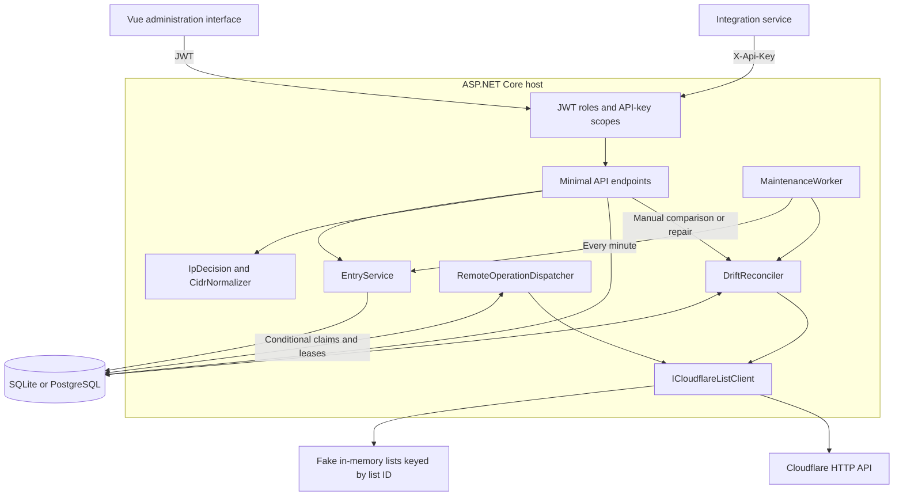
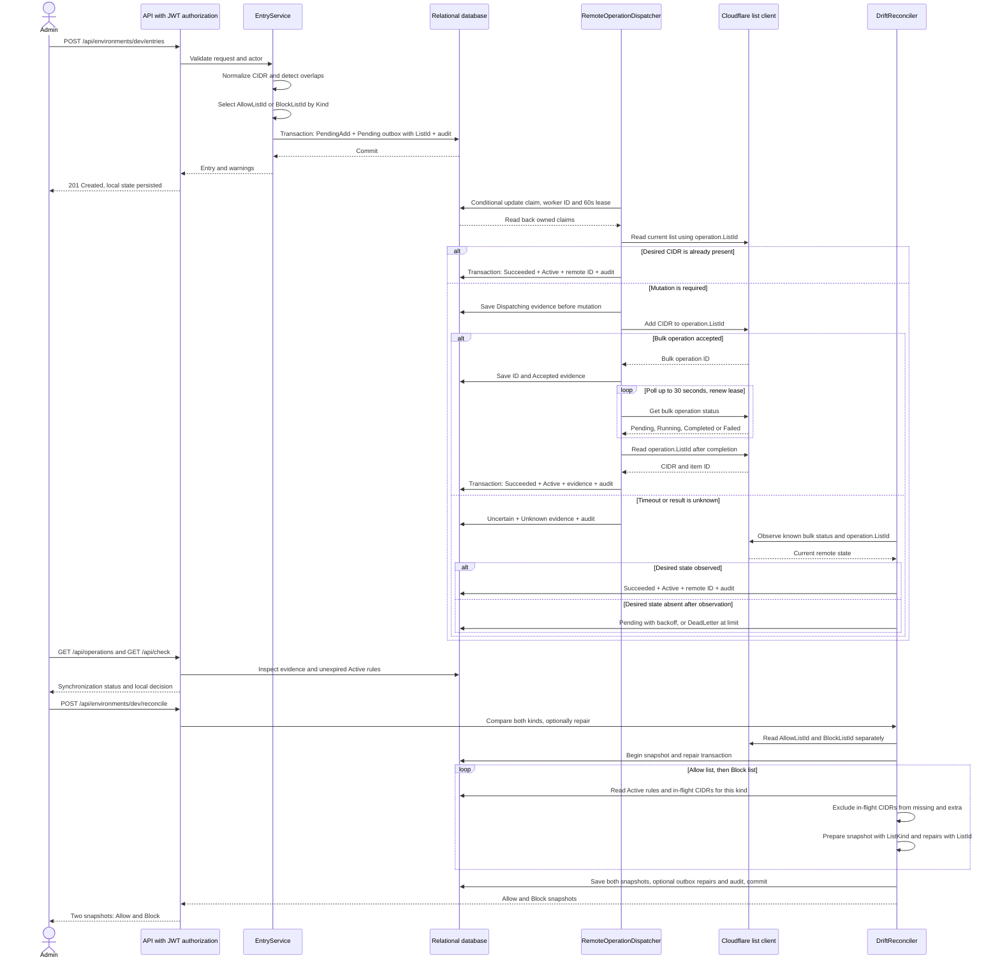
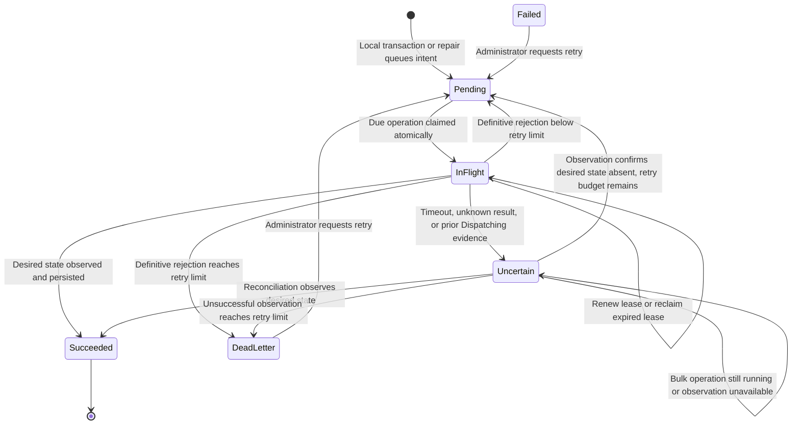
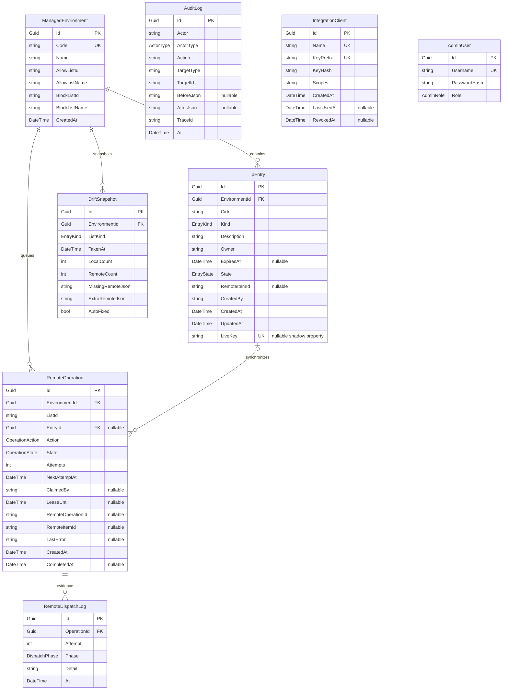

# Architecture / 系統架構

The API stores desired policy and durable synchronization intent locally; background workers make separate allow and block CIDR lists converge for each environment. IP decisions read the local database and never wait for a remote API call.

API 在本機資料庫保存期望規則及同步意圖，由背景工作逐步收斂各環境獨立的允許與封鎖 CIDR 清單。IP 判斷只讀取本機資料庫，不等待遠端 API。

## Components / 元件

- 規則服務 (EntryService) validates normalization, overlap, ownership metadata, and expiry before saving the rule, outbox operation, and audit record in one transaction. 新增時將規則、操作與稽核紀錄寫入同一交易；刪除及到期會排入移除操作。
- IP 判斷邏輯 (IpDecision) evaluates only unexpired Active rules, with Block first. 只有未到期的 Active 規則參與判斷，封鎖優先。
- 遠端派發工作 (RemoteOperationDispatcher) checks every two seconds, claims at most 20 operations, and renews 60-second leases. 每兩秒執行，單批最多 20 筆，租約為 60 秒並持續續期。
- 背景維護工作 (MaintenanceWorker) handles expiry and uncertain results every minute; every ten minutes it records comparison-only snapshots for all environments. 每分鐘處理到期及不確定結果，每十分鐘對所有環境保存不自動修復的快照。
- 遠端清單介面 (ICloudflareListClient) selects a process-local simulator or an HTTP client with a 15-second timeout. 模擬模式只有程序內記憶體；真實模式呼叫 HTTP API，單次逾時 15 秒。
- API 查詢、前端靜態檔、`/scalar`、`/openapi/v1.json` 與 `/health` 由同一主機提供。The health endpoint is liveness only, without dependency checks.

## Add and synchronize / 新增與同步

HTTP 201 proves the local transaction committed. It does not prove synchronization. A definitive rejection follows the bounded-retry path in the state diagram; a completed bulk operation is verified against list contents before activation.

HTTP 201 只代表本機交易已提交。明確拒絕依狀態圖退避重試；遠端 bulk operation 完成後，仍會讀取清單確認結果才啟用。

## Operation lifecycle / 遠端操作狀態

- 遠端操作 (RemoteOperation) keeps `Failed` as an accepted retryable state, but automatic failures currently transition to Pending or DeadLetter. `Failed` 是可手動重試狀態；目前自動失敗分支使用 Pending 或 DeadLetter。
- 派發證據 (RemoteDispatchLog) is committed before calling the remote mutation. Reclaiming an expired lease with existing evidence enters Uncertain instead of blindly repeating a mutation. 舊租約已有呼叫證據時，先轉為不確定結果並比對，避免盲目重送。
- 重試次數 (Attempts) counts definitive failures or unsuccessful uncertain-result observations. Delay is `min(600, 5 × 2^attempts)` seconds; the default limit is six. 手動重試不清空累積次數，會重設可執行時間與先前錯誤資訊。
- IP 規則 (IpEntry) follows PendingAdd → Active → PendingRemove → Removed. DeadLetter changes its rule to Failed; a retry restores PendingAdd or PendingRemove according to the operation action. 同一規則若另有未結束操作，刪除或手動重試會受到限制。

## Drift and remote policy / 漂移與遠端策略

漂移比對服務 (DriftReconciler) first resolves uncertain operations using their persisted 清單識別碼 (ListId), then compares normalized CIDRs separately for Allow and Block. Each reconciliation saves and returns two 漂移快照 (DriftSnapshot), distinguished by 清單種類 (ListKind). 比對先以操作保存的清單識別碼 (ListId) 處理不確定結果，再分別保存 Allow／Block 的 Active 規則與對應遠端清單的差異，一次回傳兩筆漂移快照 (DriftSnapshot)。

- Missing CIDRs can queue Add operations when `autoFix=true`. 缺少項目以 outbox 非同步新增。
- PendingAdd/PendingRemove CIDRs and rules with Pending/InFlight/Uncertain operations are excluded from both missing and extra, only in their own kind's list. Unknown remote items with an open Remove operation are excluded too. 同步中規則與已排程移除的未知項目不列入漂移；排除只作用於對應種類的清單。
- Extra remote items queue Remove operations only when auto-fix is requested and `Cloudflare:AllowRemoveUnknown=true`; items still referenced locally are protected. 遠端多出項目須同時明確要求修復、允許刪除未知項目，且不能仍被本機規則使用。
- 自動修復標記 (AutoFixed) records the repair request, not remote completion. 修復完成須另外檢查操作狀態與後續快照。
- Each environment maps to two distinct Cloudflare Lists. WAF rules reference the allow list with skip/allow and the block list with block, with rule order and skip scope preserving Block precedence. No WAF policy is created by synchronization. 每個環境對應兩張獨立清單，WAF 規則分別引用允許及封鎖清單；規則順序與跳過範圍須維持封鎖優先，策略需另行設定。
- 遠端操作 (RemoteOperation) persists 清單識別碼 (ListId) when queued, including automatic repairs. Dispatch, uncertain-result observation, and remote item ID lookup use that saved target rather than recomputing it from environment settings. 操作排程時即綁定清單，後續確認與重試都沿用；同一 CIDR 的 Allow 與 Block 操作互不影響。
- Fake state resets on restart and is not shared among API instances. Local database records persist; a later comparison exposes the missing remote contents. 模擬模式使用單一執行個體，重啟後可由管理員要求修復。

## Data model / 資料模型

- 環境 (ManagedEnvironment) owns rules, operations, and snapshots through foreign keys. IP 規則 (IpEntry) is optional on operations because deletion of an unknown remote item has no local rule.
- 有效規則鍵 (LiveKey) is an EF shadow property derived from environment, CIDR, and kind. Its unique index protects concurrent writes; it becomes null only after removal. 唯一索引允許已移除規則保留歷史，並可重新建立同一規則。
- 稽核紀錄 (AuditLog) references targets through descriptive identifiers, without polymorphic foreign keys. 避免將歷史紀錄綁定到單一實體生命週期。
- 整合客戶端 (IntegrationClient) stores only a hashed key and unique prefix; 管理帳號 (AdminUser) stores salted password hashes. 身分與稽核使用名稱或識別碼關聯，不建立跨身分的外鍵。
- UTC 時間轉換器 (UtcTicksConverter) stores timestamps as integer ticks across both providers. Database creation uses `EnsureCreated`; existing schemas are not upgraded automatically.

## Authorization boundaries / 授權邊界

| Caller / 身分 | Read / 讀取 | Write / 寫入 |
| --- | --- | --- |
| Admin JWT | All management screens and decisions / 全部管理與判斷 | Rules, retries, reconcile, integration keys / 規則、重試、比對、金鑰 |
| Viewer JWT | Entries, operations, snapshots, decisions / 規則、操作、快照、判斷 | None / 無 |
| API key | `allowlist:read` and/or `ip:check` | `allowlist:write` on integration rule routes only |

API keys are shown once, stored as SHA-256 hashes, found by unique prefix, and compared using `FixedTimeEquals`. Revoked prefixes are retained. JWT signing requires at least 32 UTF-8 bytes, and tokens expire after eight hours. Login failure throttling is in-memory per source IP and application instance.

API 金鑰只顯示一次，以雜湊保存並透過唯一前綴查找；撤銷後保留前綴。JWT 簽章金鑰至少 32 個 UTF-8 bytes，工作階段八小時到期。登入失敗限流保存在單一執行個體的記憶體中。
